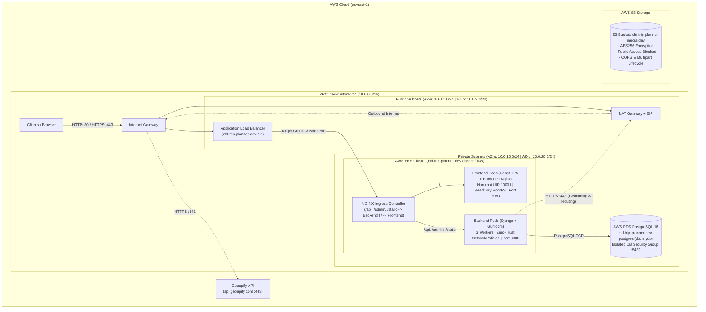

# ELD Trip Planner

A full-stack Electronic Logging Device (ELD) route and Hours-of-Service (HOS) trip planning web application. Built with **React**, **Django REST Framework + Gunicorn**, **Geoapify Geocoding & Routing**, **Kubernetes (EKS)**, and **reusable Terraform AWS modules** emulated locally at zero cost using **Floci**.

---

## 🏛️ Cloud Infrastructure & Kubernetes Architecture

The cloud infrastructure is built with modular **Terraform** (`VPC`, `EKS`, `RDS`, `ALB`, `S3`, `IAM`) parameterized via `variables.tf` and `terraform.tfvars`, and tested locally with **Floci** (an open-source AWS emulator with Docker-backed EKS, RDS, and ELBv2). Workloads deploy to Kubernetes using **Kustomize** (`base` + `overlays`) with hardened containers and zero-trust `NetworkPolicy` isolation.



### Architecture Highlights

- **Reusable Modular Terraform:** Environment configuration (`terraform/environments/dev/`) consumes parameterized modules (`vpc`, `rds`, `eks`, `alb`, `s3-secure-bucket`) driven solely by `variables.tf` and `terraform.tfvars` (`project_name = "eld-trip-planner"`).
- **Multi-AZ VPC & Networking:** Custom `10.0.0.0/16` VPC separating public edge resources (ALB, NAT Gateway) from private compute and database tiers across two Availability Zones.
- **Production Python WSGI Runtime:** Django backend runs behind multi-worker Gunicorn (port 8000) and integrates with the Geoapify API (`GEOAPIFY_API_KEY`) for trip geocoding and HOS route calculation.
- **Managed Database (RDS):** PostgreSQL 16 provisioned via `aws_db_instance` with encrypted storage, dedicated DB subnet group, and VPC-scoped security rules.
- **Container Hardening & Zero-Trust Networking:**
  - Frontend runs as a non-root container (UID 10001) with `readOnlyRootFilesystem: true` and dedicated writable `emptyDir` cache/run mounts (`/var/cache/nginx`, `/var/run`, `/tmp`).
  - Namespace traffic is locked down with a default-deny-all `NetworkPolicy`, allowing only explicit DNS (`:53`), RDS (`:7001`), Ingress traffic, and outbound HTTPS (`:443`) to external APIs.

---

## 🚀 Local Cloud Simulation Setup (Floci + EKS + RDS)

### 1. Start Floci (Local AWS Emulator)

(Includes port `8080:80` for the ALB listener and `--security-opt label=disable` for SELinux hosts such as Fedora.)

```bash
docker run -d --name floci \
  -p 4566:4566 \
  -p 8080:80 \
  -v /var/run/docker.sock:/var/run/docker.sock \
  -v floci_data:/app/data \
  -u root \
  --security-opt label=disable \
  -e FLOCI_SECURITY_ALLOW_UNSAFE_NETWORK_EXPOSURE=true \
  -e FLOCI_STORAGE_MODE=persistent \
  floci/floci:latest
```

- **Web Console:** `http://localhost:4566/_floci/ui`

### 2. Provision AWS Infrastructure (VPC, RDS, EKS, ALB, S3)

```bash
cd terraform/environments/dev
tflocal init
tflocal apply
```

(Alternatively, use plain `terraform` or `lstk terraform` with provider endpoints pointing to `http://localhost:4566`.)

### 3. Connect `kubectl` to the Local EKS (k3s) Cluster

```bash
docker exec floci-aws-eks-eld-trip-planner-dev-cluster cat /etc/rancher/k3s/k3s.yaml \
  | sed 's/127.0.0.1:6443/127.0.0.1:6500/g' > ~/.kube/config

kubectl get nodes
```

### 4. Build & Load Container Images

```bash
# From project root
docker build -t eld-trip-planner-frontend:v1.0.0 ./frontend
docker build -t eld-trip-planner-backend:v1.0.0 ./backend

docker save eld-trip-planner-frontend:v1.0.0 | docker exec -i floci-aws-eks-eld-trip-planner-dev-cluster ctr images import -
docker save eld-trip-planner-backend:v1.0.0 | docker exec -i floci-aws-eks-eld-trip-planner-dev-cluster ctr images import -
```

(Ensure the `image:` fields in `kubernetes/base/` match these tags or your Docker Hub repository tags.)

### 5. Install NGINX Ingress & Deploy Workloads

```bash
# 1. Install NGINX Ingress Controller
kubectl apply -f https://raw.githubusercontent.com/kubernetes/ingress-nginx/controller-v1.12.1/deploy/static/provider/baremetal/deploy.yaml

# 2. Deploy Kustomize dev overlay
kubectl apply -k kubernetes/overlays/dev
```

### 6. Wire RDS Service, Egress Policy & Secrets (Never Commit API Keys!)

- Point Kubernetes `dev-postgres` / `db` Services to the Terraform `rds_endpoint` (`tflocal output rds_endpoint`, e.g., `172.17.0.2:7001`) and remove the in-cluster `dev-postgres` StatefulSet if using RDS.
- Apply the backend egress `NetworkPolicy` allowing DNS (`:53`), RDS (`172.17.0.2:7001`), and HTTPS (`:443` for Geoapify).
- Inject your `GEOAPIFY_API_KEY` securely (via a gitignored `.env.secret` file or directly at runtime):

    ```bash
    kubectl set env deployment/dev-backend GEOAPIFY_API_KEY="your_geoapify_key" -n frontend-dev
    ```

- Run Django migrations against RDS:

    ```bash
    kubectl exec -n frontend-dev deployment/dev-backend -- python manage.py migrate --noinput
    ```

### 7. Sync ALB Target Group & Open the App

Check the NodePort assigned to `ingress-nginx-controller` (`kubectl get svc -n ingress-nginx`) and update `ingress_node_port` in `terraform/environments/dev/terraform.tfvars`, then re-run `tflocal apply`.

- **Via Terraform ALB:** Open the `website_url` output (`http://eld-trip-planner-dev-alb-...elb.localhost.floci.io:8080`)
- **Via Ingress directly:** `http://<eks-node-ip>:<ingress-nodeport>`

---

## 📁 Project Structure

```text
├── backend/          # Django settings, WSGI/ASGI & production Gunicorn Dockerfile
├── frontend/         # React + Vite SPA served via hardened non-root Nginx
├── kubernetes/       # Kustomize base & overlays (dev/staging/prod), NetworkPolicies & Ingress
└── terraform/        # Modular IaC (environments/dev + reusable modules: vpc, rds, eks, alb, s3)
```

---

## 🗺️ Production Hardening Roadmap

- [ ] **GitOps RDS & NetworkPolicy Manifests:** Commit the RDS `Endpoints`/`Service` and `allow-backend-egress` `NetworkPolicy` into `kubernetes/overlays/` so `kubectl apply -k` is 100% self-contained.
- [ ] **AWS Secrets Manager + External Secrets Operator:** Fetch `GEOAPIFY_API_KEY`, Django `SECRET_KEY`, and RDS credentials automatically from `aws_secretsmanager_secret` instead of `kubectl set env` or `.env.secret`.
- [ ] **ECR + GitHub Actions CI/CD:** Automate image builds/pushes to AWS ECR, Terraform CI (`fmt`, `validate`, `TFLint`, `Trivy`), and EKS worker node (`aws_eks_node_group`) pulls.
- [ ] **HTTPS / TLS & AWS Load Balancer Controller:** Attach an AWS ACM SSL certificate on ALB port 443, redirect HTTP→HTTPS, and manage ALBs dynamically via Kubernetes Ingress.